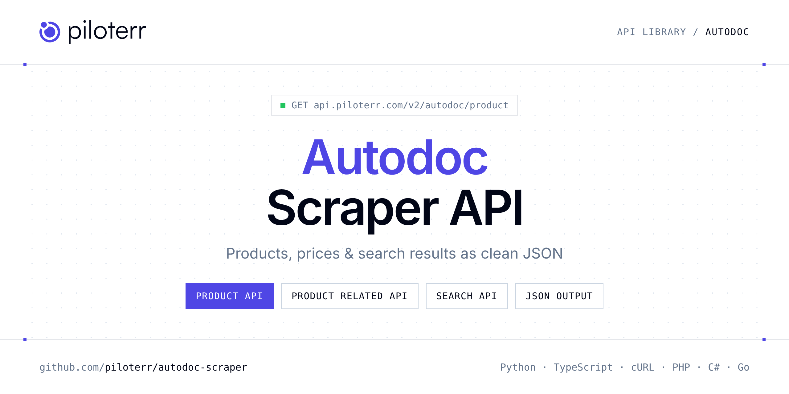

<p align="center">
  <a href="https://www.piloterr.com"></a>
</p>

# Autodoc Scraper API

[](https://discord.gg/CFj3ph8aHU) [](https://app.piloterr.com) [](https://app.piloterr.com/openapi) [](LICENSE)

The **Piloterr Autodoc Scraper API** lets you extract public data from Autodoc as **clean, structured JSON** — no proxies, headless browsers or HTML parsing to maintain. Endpoints available in production:

- **Autodoc Product API** — Scrape Autodoc product pages: price, specs, EAN, images, compatibility, and TecDoc-related vehicle data via the Related endpoint.
- **Autodoc Product Related API** — Vehicle fitment lines per maker for an Autodoc product.
- **Autodoc Search API** — Search Autodoc by URL: keyword pages use `/search?keyword=…` (e.g.

Use it for price monitoring, assortment tracking, competitor analysis, product research or catalog enrichment.

| Endpoint | Path | Credits | What you get |
|---|---|---|---|
| [Autodoc Product API](#autodoc-product-api) | `/v2/autodoc/product` | 2 | Scrape Autodoc product pages |
| [Autodoc Product Related API](#autodoc-product-related-api) | `/v2/autodoc/product/related` | 2 | Vehicle fitment lines per maker for an Autodoc product. All parameters from Product `fetch.params` are required. |
| [Autodoc Search API](#autodoc-search-api) | `/v2/autodoc/search` | 2 | Search Autodoc by URL |

## Table of contents

- [How it works](#how-it-works)
- [Autodoc Product API](#autodoc-product-api)
- [Autodoc Product Related API](#autodoc-product-related-api)
- [Autodoc Search API](#autodoc-search-api)
- [Code examples in other languages](#code-examples-in-other-languages)
- [Practical use cases](#practical-use-cases)
- [Why Piloterr?](#why-piloterr)
- [FAQ](#faq)
- [Official SDKs](#official-sdks)
- [Related scrapers](#related-scrapers)
- [Support](#support)

## How it works

1. **Create a free Piloterr account** and copy your API key from the [dashboard](https://app.piloterr.com).
2. **Send a `GET` (or `POST`) request** to `https://api.piloterr.com/v2/...` with the header `x-api-key: YOUR_API_KEY`.
3. **Receive structured JSON** — Piloterr handles rendering, proxies, retries and parsing.

```bash
export PILOTERR_API_KEY="your-api-key"
pip install requests        # Python
# TypeScript: Node.js 18+ (native fetch), run with `npx tsx file.ts`
```

> Every endpoint accepts both `GET` (query string) and `POST` (JSON body with the same fields).

## Autodoc Product API

Scrape Autodoc product pages: price, specs, EAN, images, compatibility, and TecDoc-related vehicle data via the Related endpoint.

`GET | POST https://api.piloterr.com/v2/autodoc/product` · **2 credits per request** · [Full reference](https://app.piloterr.com/openapi)

### Request parameters

| Parameter | Type | Required | Description |
|---|---|---|---|
| `query` | string | ✅ | HTTPS URL of an Autodoc product page. |

### Python example

```python
import json
import os
import requests

response = requests.get(
    "https://api.piloterr.com/v2/autodoc/product",
    headers={"x-api-key": os.environ["PILOTERR_API_KEY"]},
    params={
        "query": "https://www.auto-doc.fr/ridex/7999541",
    },
    timeout=120,
)
response.raise_for_status()
data = response.json()

print(json.dumps(data, indent=2, ensure_ascii=False)[:2000])
```

### TypeScript example

```typescript
type AutodocProduct = {
  ean?: string;
  name?: string;
  price?: number;
  images?: string[];
  rating?: number;
  seller?: string;
  brand_no?: number;
  currency?: string;
  features?: string[];
  subtitle?: string;
  reference?: string;
  seller_id?: number;
  generic_id?: number;
  product_id?: number;
  breadcrumbs?: {
    url?: string;
    name?: string;
  }[];
  oem_numbers?: {
    url?: string;
    label?: string;
  }[];
  product_url?: string;
  seo_summary?: {
    moteurs?: string;
    modeles_de_voitures?: string;
    annees_de_fabrication?: string;
    "numero(s)_de_piece_oe"?: string;
    "puissance_(kilowatts)"?: string;
    numero_d_article_du_fabricant?: string;
    "puissance_du_moteur_(chevaux)"?: string;
  };
  availability?: string;
  generic_name?: string;
  goods_ending?: number;
  compatibility?: {
    cars?: {
      fetch?: Record<string, unknown>;
      maker?: string;
      maker_id?: number;
      vehicle_type?: string;
    }[];
    trucks?: unknown[];
  };
  has_360_photo?: boolean;
  reviews_count?: number;
  specifications?: {
    etat?: string;
    hauteur?: string;
    perfore?: string;
    surface?: string;
    diametre?: string;
    materiel?: string;
    fabricant?: string;
    traitement?: string;
    numero_de_ean?: string;
    nombre_de_trous?: string;
    numero_d_article?: string;
    annee_a_partir_de?: string;
    cote_d_assemblage?: string;
    cercle_de_percage_ø?: string;
    diametre_du_centrage?: string;
    type_de_disque_de_frein?: string;
    epaisseur_du_disque_de_frein?: string;
    diametre_d_alesage_du_boulon_de_roue?: string;
    article_complementaire_info_complementaire_2?: string;
  };
  [key: string]: unknown;
};

const params = new URLSearchParams({
  "query": "https://www.auto-doc.fr/ridex/7999541",
});

const response = await fetch(`https://api.piloterr.com/v2/autodoc/product?${params}`, {
  headers: { "x-api-key": process.env.PILOTERR_API_KEY! },
});
if (!response.ok) throw new Error(`Piloterr error ${response.status}: ${await response.text()}`);

const data = (await response.json()) as AutodocProduct;

console.log(JSON.stringify(data, null, 2).slice(0, 2000));
```

<details>
<summary><b>POST variant</b></summary>

```http
POST https://api.piloterr.com/v2/autodoc/product
x-api-key: YOUR_API_KEY
Content-Type: application/json

{"query": "https://www.auto-doc.fr/ridex/7999541"}
```
</details>

### Output example

Example response from the API reference, abridged — real values depend on the page you scrape.

```json
{
  "ean": "4059191318797",
  "name": "RIDEX 82B0696 Disque de freinEssieu avant, 238x8mm, 4/6x100, Plein, Fonte",
  "price": 13.99,
  "images": [
    "https://media.autodoc.de/360_photos/7999541/preview.jpg",
    "https://cdn.autodoc.de/thumb?id=7999541&m=1&n=0&lng=fr&rev=94078030"
  ],
  "rating": 8,
  "seller": "example",
  "brand_no": 100015,
  "currency": "EUR",
  "features": [
    "Disques de frein standard conditionnés dans un emballage huilé",
    "Matériel : fonte GG20"
  ],
  "subtitle": "Essieu avant, 238x8mm, 4/6x100, Plein, Fonte",
  "reference": "82B0696",
  "seller_id": 485,
  "generic_id": 82,
  "product_id": 7999541,
  "breadcrumbs": [
    {
      "url": "https://www.auto-doc.fr/#parts",
      "name": "Pièces auto magasin en ligne"
    },
    {
      "url": "https://www.auto-doc.fr/pieces-detachees",
      "name": "Catalogue de pièces"
    }
  ],
  "oem_numbers": [
    {
      "url": "https://www.auto-doc.fr/pieces-detachees/oem/7701204285",
      "label": "OE 77 01 204 285. RENAULT"
    },
    {
      "url": "https://www.auto-doc.fr/pieces-detachees/oem/7700716947",
      "label": "OE 77 00 716 947. RENAULT"
    }
  ],
  "product_url": "https://www.auto-doc.fr/ridex/7999541",
  "seo_summary": {
    "moteurs": "1.2; 1.2 16V; 1.1; 1.9 D; 1.4; 1.0; 1.6 D",
    "modeles_de_voitures": "Renault Twingo 1; Clio 1; Renault Supercinq; R5 3/5 portes; Renault Rapid Van; Renault Twingo 1 Van; Renault Clio Van s57; Super 5 Van (s40)",
    "annees_de_fabrication": "1980-2007",
    "numero(s)_de_piece_oe": "77 01 204 285, 77 00 716 947, 77 01 716 947",
    "puissance_(kilowatts)": "27-52 kW",
    "numero_d_article_du_fabricant": "82B0696",
    "puissance_du_moteur_(chevaux)": "37-71 CV"
  },
  "availability": "En stock",
  "generic_name": "Disque de frein",
  "goods_ending": 392,
  "compatibility": {
    "cars": [
      {
        "fetch": {},
        "maker": "RENAULT",
        "maker_id": 93,
        "vehicle_type": "pkw"
      }
    ],
    "trucks": []
  },
  "has_360_photo": true,
  "reviews_count": 28,
  "specifications": {
    "etat": "Neuf",
    "hauteur": "41",
    "perfore": "non",
    "surface": "nu / non protégé / non plastifié",
    "diametre": "238",
    "materiel": "Fonte",
    "fabricant": "RIDEX",
    "traitement": "non-traité",
    "numero_de_ean": "4059191318797",
    "nombre_de_trous": "4 / 6",
    "numero_d_article": "82B0696",
    "annee_a_partir_de": "Cette caractéristique varie en fonction du modèle de voiture.",
    "cote_d_assemblage": "Essieu avant",
    "cercle_de_percage_ø": "100",
    "diametre_du_centrage": "61,1",
    "type_de_disque_de_frein": "Plein",
    "epaisseur_du_disque_de_frein": "8",
    "diametre_d_alesage_du_boulon_de_roue": "13",
    "article_complementaire_info_complementaire_2": "sans vis / boulons"
  }
}
```

### Response fields

| Field | Type | Description |
|---|---|---|
| `ean` | string |  |
| `name` | string |  |
| `price` | number |  |
| `images` | string[] |  |
| `rating` | integer |  |
| `seller` | string |  |
| `brand_no` | integer |  |
| `currency` | string |  |
| `features` | string[] |  |
| `subtitle` | string |  |
| `reference` | string |  |
| `seller_id` | integer |  |
| `generic_id` | integer |  |
| `product_id` | integer |  |
| `breadcrumbs[]` | object[] |  |
| `breadcrumbs[].url` | string |  |
| `breadcrumbs[].name` | string |  |
| `oem_numbers[]` | object[] |  |
| `oem_numbers[].url` | string |  |
| `oem_numbers[].label` | string |  |
| `product_url` | string |  |
| `seo_summary` | object |  |
| `seo_summary.moteurs` | string |  |
| `seo_summary.modeles_de_voitures` | string |  |
| `seo_summary.annees_de_fabrication` | string |  |

## Autodoc Product Related API

Vehicle fitment lines per maker for an Autodoc product. All parameters from Product `fetch.params` are required.

`GET | POST https://api.piloterr.com/v2/autodoc/product/related` · **2 credits per request** · [Full reference](https://app.piloterr.com/openapi)

### Request parameters

| Parameter | Type | Required | Description |
|---|---|---|---|
| `query` | string | ✅ | Same HTTPS product page URL as Product. |
| `maker_id` | number | ✅ | TecDoc maker id from `compatibility.cars[]` / `compatibility.trucks[]`, e.g. `93` for RENAULT. |
| `vehicle_type` | string | ✅ | Required. `pkw` (passenger cars) or `lkw` (commercial). Must match the compatibility row. |
| `maker_name` | string | ✅ | Required maker label from compatibility, e.g. `RENAULT`. Used to parse vehicle lines. |
| `product_id` | number | ✅ | Required article id from Product response or URL path, e.g. `7999541`. |

### Python example

```python
import json
import os
import requests

response = requests.get(
    "https://api.piloterr.com/v2/autodoc/product/related",
    headers={"x-api-key": os.environ["PILOTERR_API_KEY"]},
    params={
        "query": "https://www.auto-doc.fr/ridex/7999541",
        "maker_id": "93",
        "vehicle_type": "pkw",
        "maker_name": "RENAULT",
        "product_id": "7999541",
    },
    timeout=120,
)
response.raise_for_status()
data = response.json()

print(json.dumps(data, indent=2, ensure_ascii=False)[:2000])
```

### TypeScript example

```typescript
type AutodocProductRelated = {
  models?: string[];
  maker_id?: number;
  vehicles?: {
    raw?: string;
    brand?: string;
    model?: string;
    end_date?: string;
    model_id?: number;
    start_date?: string;
  }[];
  product_id?: number;
  product_url?: string;
  vehicle_type?: string;
};

const params = new URLSearchParams({
  "query": "https://www.auto-doc.fr/ridex/7999541",
  "maker_id": "93",
  "vehicle_type": "pkw",
  "maker_name": "RENAULT",
  "product_id": "7999541",
});

const response = await fetch(`https://api.piloterr.com/v2/autodoc/product/related?${params}`, {
  headers: { "x-api-key": process.env.PILOTERR_API_KEY! },
});
if (!response.ok) throw new Error(`Piloterr error ${response.status}: ${await response.text()}`);

const data = (await response.json()) as AutodocProductRelated;

console.log(JSON.stringify(data, null, 2).slice(0, 2000));
```

<details>
<summary><b>POST variant</b></summary>

```http
POST https://api.piloterr.com/v2/autodoc/product/related
x-api-key: YOUR_API_KEY
Content-Type: application/json

{"query": "https://www.auto-doc.fr/ridex/7999541", "maker_id": "93", "vehicle_type": "pkw", "maker_name": "RENAULT", "product_id": "7999541"}
```
</details>

### Output example

Example response from the API reference, abridged — real values depend on the page you scrape.

```json
{
  "models": [
    "RENAULT Rapid (F40, G40) (Année de construction 07.1985 - 11.2001)",
    "RENAULT Clio I 3/5 portes (Année de construction 05.1990 - 09.1998)"
  ],
  "maker_id": 93,
  "vehicles": [
    {
      "raw": "RENAULT Rapid (F40, G40) (Année de construction 07.1985 - 11.2001)",
      "brand": "RENAULT",
      "model": "Rapid (F40, G40) (Année de construction 07.1985 - 11.2001)",
      "end_date": "11.2001",
      "model_id": 17,
      "start_date": "07.1985"
    },
    {
      "raw": "RENAULT Clio I 3/5 portes (Année de construction 05.1990 - 09.1998)",
      "brand": "RENAULT",
      "model": "Clio I 3/5 portes (Année de construction 05.1990 - 09.1998)",
      "end_date": "09.1998",
      "model_id": 21,
      "start_date": "05.1990"
    }
  ],
  "product_id": 7999541,
  "product_url": "https://www.auto-doc.fr/ridex/7999541",
  "vehicle_type": "pkw"
}
```

### Response fields

| Field | Type | Description |
|---|---|---|
| `models` | string[] |  |
| `maker_id` | integer |  |
| `vehicles[]` | object[] |  |
| `vehicles[].raw` | string |  |
| `vehicles[].brand` | string |  |
| `vehicles[].model` | string |  |
| `vehicles[].end_date` | string |  |
| `vehicles[].model_id` | integer |  |
| `vehicles[].start_date` | string |  |
| `product_id` | integer |  |
| `product_url` | string |  |
| `vehicle_type` | string |  |

## Autodoc Search API

Search Autodoc by URL: keyword pages use `/search?keyword=…` (e.g. `frein` on auto-doc.fr). Extract product cards, prices, and pagination.

`GET | POST https://api.piloterr.com/v2/autodoc/search` · **2 credits per request** · [Full reference](https://app.piloterr.com/openapi)

### Request parameters

| Parameter | Type | Required | Description |
|---|---|---|---|
| `query` | string | ✅ | Full Autodoc search/listing URL, or path only when `domain` sets the shop. |
| `domain` | string | — | Regional shop hostname without `https://` or `www.` (e.g. `auto-doc.fr`, `autodoc.de`). Omit to default to `autodoc.de`. |

### Python example

```python
import json
import os
import requests

response = requests.get(
    "https://api.piloterr.com/v2/autodoc/search",
    headers={"x-api-key": os.environ["PILOTERR_API_KEY"]},
    params={
        "query": "https://www.auto-doc.fr/search?keyword=frein",
    },
    timeout=120,
)
response.raise_for_status()
data = response.json()

print(json.dumps(data, indent=2, ensure_ascii=False)[:2000])
```

### TypeScript example

```typescript
type AutodocSearch = {
  results?: {
    name?: string;
    price?: number;
    seller?: string;
    brand_no?: string;
    discount?: number;
    "360_photo"?: string;
    reference?: string;
    seller_id?: number;
    product_id?: string;
    product_url?: string;
    availability?: string;
    generic_name?: string;
    product_image?: string;
    reviews_count?: number;
    original_price?: number;
  }[];
  pagination?: {
    next?: number;
    current?: number;
    other_pages?: number[];
    has_next_page?: boolean;
  };
};

const params = new URLSearchParams({
  "query": "https://www.auto-doc.fr/search?keyword=frein",
});

const response = await fetch(`https://api.piloterr.com/v2/autodoc/search?${params}`, {
  headers: { "x-api-key": process.env.PILOTERR_API_KEY! },
});
if (!response.ok) throw new Error(`Piloterr error ${response.status}: ${await response.text()}`);

const data = (await response.json()) as AutodocSearch;

console.log(JSON.stringify(data, null, 2).slice(0, 2000));
```

<details>
<summary><b>POST variant</b></summary>

```http
POST https://api.piloterr.com/v2/autodoc/search
x-api-key: YOUR_API_KEY
Content-Type: application/json

{"query": "https://www.auto-doc.fr/search?keyword=frein"}
```
</details>

### Output example

Example response from the API reference, abridged — real values depend on the page you scrape.

```json
{
  "results": [
    {
      "name": "RIDEX Étrier de frein Essieu avant gauche, Essieu avant, Fonte, 162 mm, sans fixation",
      "price": 42.99,
      "seller": "example",
      "brand_no": "100015",
      "discount": 42,
      "360_photo": "https://media.autodoc.de/360_photos/8381120",
      "reference": "78B0410",
      "seller_id": 485,
      "product_id": "8381120",
      "product_url": "https://www.auto-doc.fr/ridex/8381120",
      "availability": "En stock",
      "generic_name": "Étrier de frein",
      "product_image": "https://media.autodoc.de/360_photos/8381120/preview.jpg",
      "reviews_count": 10,
      "original_price": 74.2
    },
    {
      "name": "RIDEX Étrier de frein Essieu avant gauche, Essieu avant, Fonte grise, 134 mm, sans fixation",
      "price": 36.99,
      "seller": "example",
      "brand_no": "100015",
      "discount": 47,
      "360_photo": "https://media.autodoc.de/360_photos/8099284",
      "reference": "78B0328",
      "seller_id": 485,
      "product_id": "8099284",
      "product_url": "https://www.auto-doc.fr/ridex/8099284",
      "availability": "En stock",
      "generic_name": "Étrier de frein",
      "product_image": "https://media.autodoc.de/360_photos/8099284/preview.jpg",
      "reviews_count": 18,
      "original_price": 70.3
    }
  ],
  "pagination": {
    "next": 2,
    "current": 1,
    "other_pages": [
      2,
      3
    ],
    "has_next_page": true
  }
}
```

### Response fields

| Field | Type | Description |
|---|---|---|
| `results[]` | object[] |  |
| `results[].name` | string |  |
| `results[].price` | number |  |
| `results[].seller` | string |  |
| `results[].brand_no` | string |  |
| `results[].discount` | integer |  |
| `results[].360_photo` | string |  |
| `results[].reference` | string |  |
| `results[].seller_id` | integer |  |
| `results[].product_id` | string |  |
| `results[].product_url` | string |  |
| `results[].availability` | string |  |
| `results[].generic_name` | string |  |
| `results[].product_image` | string |  |
| `results[].reviews_count` | integer |  |
| `results[].original_price` | number |  |
| `pagination` | object |  |
| `pagination.next` | integer |  |
| `pagination.current` | integer |  |
| `pagination.other_pages` | integer[] |  |
| `pagination.has_next_page` | boolean |  |

## Code examples in other languages

Ready-to-run examples live in the [`examples/`](examples) folder. Each one reads your key from the `PILOTERR_API_KEY` environment variable.

| Language | Product | Product Related | Search |
|---|---|---|---|
| cURL (Bash) | [`product`](examples/curl/product.sh) | [`product-related`](examples/curl/product_related.sh) | [`search`](examples/curl/search.sh) |
| PHP | [`product`](examples/php/product.php) | [`product-related`](examples/php/product_related.php) | [`search`](examples/php/search.php) |
| C# | [`product`](examples/csharp/Product.cs) | [`product-related`](examples/csharp/ProductRelated.cs) | [`search`](examples/csharp/Search.cs) |
| Go | [`product`](examples/go/product.go) | [`product-related`](examples/go/product_related.go) | [`search`](examples/go/search.go) |
| Java | [`product`](examples/java/ProductExample.java) | [`product-related`](examples/java/ProductRelatedExample.java) | [`search`](examples/java/SearchExample.java) |
| Ruby | [`product`](examples/ruby/product.rb) | [`product-related`](examples/ruby/product_related.rb) | [`search`](examples/ruby/search.rb) |
| Node.js | [`product`](examples/nodejs/product.mjs) | [`product-related`](examples/nodejs/product_related.mjs) | [`search`](examples/nodejs/search.mjs) |

## Practical use cases

- **Price monitoring** — Track prices, promotions and availability over time to react to competitors.
- **Assortment & catalog tracking** — Follow new products, delisted items and category changes.
- **Competitor analysis** — Benchmark ranges, brands and positioning across retailers.
- **Product research** — Spot best-sellers and trends from search results.
- **Catalog enrichment** — Pull titles, images and attributes into your PIM or marketplace listings.

## Why Piloterr?

- **No infrastructure** — no proxies, headless browsers or CAPTCHA solving to run yourself.
- **Structured JSON** — stable, documented fields instead of brittle HTML selectors.
- **Pay per request** — transparent credit cost per endpoint, failed requests are retried for you.
- **One API key, hundreds of sources** — Autodoc plus many other e-commerce, search and company data endpoints in the [Piloterr library](https://www.piloterr.com/library).
- **Any language** — plain HTTPS + JSON, with examples for Python, TypeScript, cURL, PHP, C#, Go, Java, Ruby and Node.js.

## FAQ

### Is it legal to scrape Autodoc?

Collecting publicly available data is generally allowed in many jurisdictions, but rules depend on your country, the data you collect and how you use it. Avoid personal data unless you have a lawful basis, respect the website's terms where they apply, and get legal advice for your specific use case. This is not legal advice.

### Do I need proxies or a headless browser?

No. Piloterr handles rendering, proxy rotation and retries on its side. You only send an HTTPS request with your `x-api-key` header and receive JSON.

### How much does a request cost?

Credits per call: `/v2/autodoc/product` **2**, `/v2/autodoc/product/related` **2**, `/v2/autodoc/search` **2**. See the [Piloterr website](https://www.piloterr.com) for plans.

### What data does the Autodoc API return?

Each endpoint returns structured JSON: **Autodoc Product** — `ean`, `name`, `price`, `images`, `rating`, `seller`; **Autodoc Product Related** — `models`, `maker_id`, `vehicles[]`, `vehicles[].raw`, `vehicles[].brand`, `vehicles[].model`; **Autodoc Search** — `results[]`, `results[].name`, `results[].price`, `results[].seller`, `results[].brand_no`, `results[].discount`.

### Can I target a specific country or language?

Yes, use `domain` — see the parameter tables above for accepted values.

### Which languages are supported?

Any language that can make an HTTP request. This README shows Python and TypeScript; the [`examples/`](examples) folder contains cURL, PHP, C#, Go, Java, Ruby and Node.js.

## Official SDKs

Use Piloterr from your own language with a typed client:

| SDK | Package | Install |
| --- | --- | --- |
| Node.js | [`@piloterr/sdk`](https://www.npmjs.com/package/@piloterr/sdk) | `npm install @piloterr/sdk` |
| Python | [`piloterr`](https://pypi.org/project/piloterr/) | `pip install piloterr` |
| Go | [`piloterr-go`](https://pkg.go.dev/github.com/piloterr/piloterr-go) | `go get github.com/piloterr/piloterr-go` |
| .NET | [`Piloterr`](https://www.nuget.org/packages/Piloterr) | `dotnet add package Piloterr` |
| Ruby | [`piloterr`](https://rubygems.org/gems/piloterr) | `gem install piloterr` |
| PHP | [`piloterr/sdk`](https://packagist.org/packages/piloterr/sdk) | `composer require piloterr/sdk` |
| Java | [`piloterr-java`](https://github.com/piloterr/piloterr-java) | build from source, see its README |
| CLI | [`@piloterr/cli`](https://www.npmjs.com/package/@piloterr/cli) | `npm install -g @piloterr/cli` |
| MCP server | [`@piloterr/mcp`](https://www.npmjs.com/package/@piloterr/mcp) | `npx -y @piloterr/mcp` |

## Related scrapers

- [About You Scraper API](https://github.com/piloterr/aboutyou-scraper)
- [Action Scraper API](https://github.com/piloterr/action-scraper)
- [Aldi Scraper API](https://github.com/piloterr/aldi-scraper)
- [Alibaba Scraper API](https://github.com/piloterr/alibaba-scraper)
- [AliExpress Scraper API](https://github.com/piloterr/aliexpress-scraper)
- [Allegro Scraper API](https://github.com/piloterr/allegro-scraper)
- [All Piloterr scrapers on GitHub](https://github.com/piloterr)

## Support

- 💬 Join the [Piloterr Discord](https://discord.gg/CFj3ph8aHU) to ask questions and share what you build.
- 📚 Browse the [API reference (OpenAPI)](https://app.piloterr.com/openapi) and the [Piloterr library](https://www.piloterr.com/library).
- 🔑 [Get your API key](https://app.piloterr.com).

---

<p align="center">
  <a href="https://www.piloterr.com">
    <picture>
      <source media="(prefers-color-scheme: dark)" srcset="images/logo-dark.svg">
      
    </picture>
  </a>
  <br>
  <sub>Built by <a href="https://www.piloterr.com">Piloterr</a> — web scraping APIs for e-commerce, search, real estate and more, one API key.</sub>
</p>

<sub>Autodoc is a trademark of its respective owner. This repository is not affiliated with or endorsed by Autodoc. Examples are released under the MIT license.</sub>
